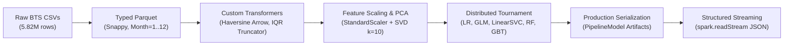

# End-to-End Supervised Learning Pipelines, Custom Transformers, and Distributed Ensembles in PySpark MLlib

- **Course:** Big Data — Group Assignment 1
- **Group 1**
- **Repository:** [`bich-le/BigData_Group1`](https://github.com/bich-le/BigData_Group1)  

---

## Table of content

- [End-to-End Supervised Learning Pipelines, Custom Transformers, and Distributed Ensembles in PySpark MLlib](#end-to-end-supervised-learning-pipelines-custom-transformers-and-distributed-ensembles-in-pyspark-mllib)
  - [Table of content](#table-of-content)
  - [1. Overview and Problem Formulation](#1-overview-and-problem-formulation)
  - [PART A: Mathematical Foundations \& Distributed Architecture (35 Marks)](#part-a-mathematical-foundations--distributed-architecture-35-marks)
    - [2. Data Scaling Mathematics \& Distributed Sparse Operations](#2-data-scaling-mathematics--distributed-sparse-operations)
      - [2.1 StandardScaler vs. MinMaxScaler Formulations](#21-standardscaler-vs-minmaxscaler-formulations)
        - [Standard Z-Score Scaling](#standard-z-score-scaling)
        - [Min-Max Range Scaling](#min-max-range-scaling)
      - [2.2 Distributed Sparsity Preservation: `withMean=True` vs. `withStd=True`](#22-distributed-sparsity-preservation-withmeantrue-vs-withstdtrue)
        - [The Zero-Centering Hazard (`withMean=True`)](#the-zero-centering-hazard-withmeantrue)
        - [Sparsity-Preserving Scaling (`withStd=True`)](#sparsity-preserving-scaling-withstdtrue)
        - [Implementation in `mllib_pipeline.py`](#implementation-in-mllib_pipelinepy)
      - [2.3 Robust Feature Scaling via Non-linear Transformation](#23-robust-feature-scaling-via-non-linear-transformation)
        - [Analytical Mechanism](#analytical-mechanism)
    - [3. Distributed PCA Mechanics](#3-distributed-pca-mechanics)
      - [3.1 Distributed Singular Value Decomposition (SVD) on `RowMatrix`](#31-distributed-singular-value-decomposition-svd-on-rowmatrix)
        - [The Distributed Bottleneck](#the-distributed-bottleneck)
        - [SVD Formulation](#svd-formulation)
        - [Concrete Matrix Walkthrough](#concrete-matrix-walkthrough)
        - [Mathematical Equivalence of SVD and PCA](#mathematical-equivalence-of-svd-and-pca)
        - [Distributed Execution in Spark MLlib](#distributed-execution-in-spark-mllib)
      - [3.2 Total Variance Retained Across $k$ Components](#32-total-variance-retained-across-k-components)
    - [4. Parametric Models vs. Tree Ensembles](#4-parametric-models-vs-tree-ensembles)
      - [4.1 ElasticNet OLS and Generalized Linear Models (GLM)](#41-elasticnet-ols-and-generalized-linear-models-glm)
        - [ElasticNet OLS Formulation](#elasticnet-ols-formulation)
        - [Generalized Linear Models (GLM) and Link Functions](#generalized-linear-models-glm-and-link-functions)
      - [4.2 Linear Support Vector Classifier (LinearSVC) and Soft-Margin Hinge Loss](#42-linear-support-vector-classifier-linearsvc-and-soft-margin-hinge-loss)
        - [Hard-Margin Geometric Formulation](#hard-margin-geometric-formulation)
        - [Soft-Margin Relaxation via Slack Variables](#soft-margin-relaxation-via-slack-variables)
        - [Soft-Margin Hinge Loss Derivation](#soft-margin-hinge-loss-derivation)
      - [4.3 Distributed Ensembles: Random Forest vs. Gradient-Boosted Trees (GBT)](#43-distributed-ensembles-random-forest-vs-gradient-boosted-trees-gbt)
        - [Random Forest (Bagging \& Subspace Sampling)](#random-forest-bagging--subspace-sampling)
        - [Gradient-Boosted Trees (Sequential Residual Fitting)](#gradient-boosted-trees-sequential-residual-fitting)
        - [Histogram-Based Feature Binning (`maxBins`)](#histogram-based-feature-binning-maxbins)
        - [Why GBT Cannot Build Trees in Parallel](#why-gbt-cannot-build-trees-in-parallel)
  - [PART B: Advanced Hands-on Implementation (65 Marks)](#part-b-advanced-hands-on-implementation-65-marks)
    - [5. Dataset Architecture \& Leakage Prevention](#5-dataset-architecture--leakage-prevention)
    - [6. Task 1: Custom PySpark Transformers \& PyArrow Optimization](#6-task-1-custom-pyspark-transformers--pyarrow-optimization)
      - [6.1 Arrow-Accelerated Haversine Distance (`pandas_udf`)](#61-arrow-accelerated-haversine-distance-pandas_udf)
      - [6.2 `OutlierIQRTruncator` (`pyspark.ml.Transformer`)](#62-outlieriqrtruncator-pysparkmltransformer)
      - [6.3 `TargetEncoder` (Leakage-Safe Categorical Target Encoding)](#63-targetencoder-leakage-safe-categorical-target-encoding)
    - [7. Task 2: End-to-End Pipeline, PCA \& MLflow Tracking](#7-task-2-end-to-end-pipeline-pca--mlflow-tracking)
      - [Cumulative Explained Variance Analysis](#cumulative-explained-variance-analysis)
      - [MLflow Model Registry Tracking](#mlflow-model-registry-tracking)
    - [8. Task 3: The 5-Model Tournament \& Distributed Tuning](#8-task-3-the-5-model-tournament--distributed-tuning)
      - [8.1 Task 1: Severe Delay Classification (SFDWS) Tournament](#81-task-1-severe-delay-classification-sfdws-tournament)
      - [8.2 Task 2: Arrival Delay Regression (FDDPS) Tournament](#82-task-2-arrival-delay-regression-fddps-tournament)
      - [8.3 Distributed Hyperparameter Grid Tuning (Random Forest Regression)](#83-distributed-hyperparameter-grid-tuning-random-forest-regression)
        - [Architectural Insights](#architectural-insights)
    - [9. Task 4: Serialization \& Real-Time Streaming Inference](#9-task-4-serialization--real-time-streaming-inference)
      - [Production Structured Streaming Workflow](#production-structured-streaming-workflow)
        - [Sample Scored Streaming Output](#sample-scored-streaming-output)
    - [10. Conclusion and Operational Recommendations](#10-conclusion-and-operational-recommendations)

---

## 1. Overview and Problem Formulation

This project evaluates large-scale supervised learning workflows within Apache Spark MLlib using the United States Department of Transportation (USDOT) 2015 Flight Delays and Performance dataset (5,819,079 flight events across 31 raw columns). We investigate two supervised operational targets:

1. **Severe Flight Delay Warning System (SFDWS) — Classification:** Binary prediction of whether an eligible flight will arrive $\ge 30$ minutes late (`severe_delay` $\in \{0, 1\}$).
2. **Flight Delay Duration Prediction System (FDDPS) — Regression:** Continuous estimation of arrival delay in minutes (`ARRIVAL_DELAY` $\in \mathbb{R}$).

The end-to-end architecture covers data validation, columnar Parquet partitioning, Arrow-accelerated custom transformers, distributed Principal Component Analysis (PCA), parallel cross-validation, an algorithm tournament across parametric and tree-ensemble families, and real-time scoring using Spark Structured Streaming.



---

## PART A: Mathematical Foundations & Distributed Architecture (35 Marks)

### 2. Data Scaling Mathematics & Distributed Sparse Operations

#### 2.1 StandardScaler vs. MinMaxScaler Formulations
Machine learning estimators exhibit varying sensitivity to feature scales:
* **Distance-based algorithms** (e.g., $k$-NN, $k$-Means, SVMs) rely on geometric distances (such as Euclidean $L_2$). Features with large unscaled domains overpower smaller ones.
* **Gradient-based optimization** (e.g., Linear Regression, GLMs, Neural Networks) achieves isotropic contour surfaces when features are standardized, preventing gradient oscillations and accelerating convergence.

##### Standard Z-Score Scaling
Centers each feature to a sample mean of 0 and scales to a sample variance of 1:

$$z_{ij} = \frac{x_{ij} - \mu_j}{\sigma_j}$$

where:
* $x_{ij}$ is the value of feature $j$ in observation $i$.
* $\mu_j = \frac{1}{n} \sum_{i=1}^n x_{ij}$ is the empirical sample mean of feature $j$.
* $\sigma_j = \sqrt{\frac{1}{n-1} \sum_{i=1}^n (x_{ij} - \mu_j)^2}$ is the sample standard deviation of feature $j$.

##### Min-Max Range Scaling
Linearly maps feature values into a bounded target interval $[a, b]$, most commonly $[0, 1]$ or $[-1, 1]$:

$$x'_{ij} = \frac{x_{ij} - x_j^{\min}}{x_j^{\max} - x_j^{\min}} (b - a) + a$$

where $x_j^{\min} = \min_{1 \le i \le n} x_{ij}$ and $x_j^{\max} = \max_{1 \le i \le n} x_{ij}$.

---

#### 2.2 Distributed Sparsity Preservation: `withMean=True` vs. `withStd=True`

In distributed large-scale machine learning, datasets with high-cardinality categorical features (e.g., one-hot encoded airport codes) are represented using `pyspark.ml.linalg.SparseVector`. Rather than storing every element, a `SparseVector` records only non-zero coordinates:
$$\mathbf{x} = [0, 12.0, 0, 0, 24.0, 0] \implies \text{indices} = [1, 4], \quad \text{values} = [12.0, 24.0]$$
For a vector of dimension $p$ containing $k \ll p$ non-zero elements, storage complexity is $\mathcal{O}(k)$ instead of $\mathcal{O}(p)$.

```
Sparse representation:   [1: 12.0, 4: 24.0]               (Storage: 2 entries)
withMean=True applied:   [-μ, 12.0-μ, -μ, -μ, 24.0-μ, -μ] (Storage: p entries, Dense!)
withStd=True applied:    [1: 12.0/σ, 4: 24.0/σ]           (Storage: 2 entries, Sparse!)
```

##### The Zero-Centering Hazard (`withMean=True`)
Zero-centering subtracts the feature mean from every observation:
$$x'_{ij} = x_{ij} - \mu_j$$
If an entry is structurally zero ($x_{ij} = 0$), its transformed value becomes:
$$x'_{ij} = 0 - \mu_j = -\mu_j$$
Because $\mu_j \neq 0$ for almost all empirical features, every implicit zero coordinate becomes an explicit, non-zero floating-point number. Consequently, the sparse vector undergoes **dense expansion**:
* Storage explodes from $\mathcal{O}(k)$ to $\mathcal{O}(p)$ per record.
* Across hundreds of millions of distributed rows, memory pressure on Spark executor JVM heaps escalates exponentially, triggering garbage collection thrashing and executor Out-Of-Memory (`java.lang.OutOfMemoryError`) crashes.

##### Sparsity-Preserving Scaling (`withStd=True`)
When mean centering is disabled (`withMean=False`) and only variance scaling is enabled (`withStd=True`):
$$x'_{ij} = \frac{x_{ij}}{\sigma_j}$$
For any structural zero ($x_{ij} = 0$):
$$x'_{ij} = \frac{0}{\sigma_j} = 0$$
Zero coordinates remain zero. The underlying sparsity index array is unaltered; no implicit zero is materialized into executor RAM.

##### Implementation in `mllib_pipeline.py`
To preserve memory efficiency across millions of flight records, our preprocessing pipeline strictly enforces:

```python
# mllib_pipeline.py: Sparsity-preserving distributed scaling
StandardScaler(
    inputCol="features_raw",
    outputCol="features_scaled",
    withStd=True,
    withMean=False,  # Enforces sparsity preservation on SparseVector
)
```

---

#### 2.3 Robust Feature Scaling via Non-linear Transformation

Real-world operational delays exhibit heavy right-skewed fat tails: the vast majority of flights experience small delays or arrive early, while a small fraction suffer severe delays exceeding several hours.

Standard z-score scaling remains sensitive to these extremes because sample mean $\mu_j$ and standard deviation $\sigma_j$ are non-robust statistics. To stabilize variance before standardizing, we apply the variance-stabilizing `log1p` transformation:

$$x'_{ij} = \ln(1 + x_{ij}) \quad \text{for } x_{ij} \ge 0$$

##### Analytical Mechanism
Taking the first derivative with respect to $x$:
$$\frac{d}{dx}\ln(1 + x) = \frac{1}{1 + x}$$
As $x \to \infty$, the marginal change $\frac{1}{1+x} \to 0$. Large absolute differences in extreme delay values are nonlinearly compressed into compact intervals, dampening the leverage of extreme outliers while strictly guaranteeing that $x'_{ij} = 0$ when $x_{ij} = 0$.

Standardized z-scores are subsequently computed on the log-transformed variables:

$$z_{ij} = \frac{\ln(1 + x_{ij}) - \mu'_j}{\sigma'_j}$$

where $\mu'_j$ and $\sigma'_j$ are the sample mean and standard deviation of the transformed feature $x'_j$.

---

### 3. Distributed PCA Mechanics

#### 3.1 Distributed Singular Value Decomposition (SVD) on `RowMatrix`

Principal Component Analysis (PCA) finds an orthogonal linear transformation that projects data from dimension $p$ to dimension $k \le p$ while maximizing explained variance.

For a zero-centered feature matrix $\mathbf{X} \in \mathbb{R}^{n \times p}$ with $n$ observations and $p$ features, the sample covariance matrix is:
$$\mathbf{C} = \frac{1}{n - 1}\mathbf{X}^T\mathbf{X}$$
Traditional PCA solves the eigenvalue problem:
$$\mathbf{C}\mathbf{v}_i = \lambda_i \mathbf{v}_i$$
where $\mathbf{v}_i$ is the $i$-th principal component (eigenvector) and $\lambda_i$ is its explained variance (eigenvalue).

##### The Distributed Bottleneck
When $n \gg p$ (e.g., $n \approx 5.6 \times 10^6$ rows in this project), collecting raw observations to a single node to form $\mathbf{C}$ causes driver memory saturation and network I/O bottlenecks.

PySpark avoids centralizing raw data by representing $\mathbf{X}$ as a distributed `RowMatrix`, where rows are partitioned across worker nodes:
$$\mathbf{X} = \begin{bmatrix} \mathbf{x}_1^T \\ \mathbf{x}_2^T \\ \vdots \\ \mathbf{x}_n^T \end{bmatrix}$$

##### SVD Formulation
Any real matrix $\mathbf{X} \in \mathbb{R}^{n \times p}$ admits a Singular Value Decomposition:
$$\mathbf{X} = \mathbf{U}\mathbf{\Sigma}\mathbf{V}^T$$
where:
* $\mathbf{U} \in \mathbb{R}^{n \times r}$ has orthonormal columns ($\mathbf{U}^T\mathbf{U} = \mathbf{I}_r$), representing the left singular vectors.
* $\mathbf{\Sigma} \in \mathbb{R}^{r \times r} = \text{diag}(\sigma_1, \sigma_2, \dots, \sigma_r)$ is a diagonal matrix containing singular values sorted in descending order: $\sigma_1 \ge \sigma_2 \ge \dots \ge \sigma_r \ge 0$.
* $\mathbf{V} \in \mathbb{R}^{p \times r}$ is an orthogonal matrix ($\mathbf{V}^T\mathbf{V} = \mathbf{I}_r$) containing the right singular vectors.
* $r = \text{rank}(\mathbf{X}) \le \min(n, p)$.

##### Concrete Matrix Walkthrough
Consider a centered $3 \times 2$ matrix $\mathbf{A}$:
$$\mathbf{A} = \begin{bmatrix} 1 & 2 \\ 0 & 0 \\ -1 & -2 \end{bmatrix}$$
Performing SVD decomposes $\mathbf{A} = \mathbf{U}\mathbf{\Sigma}\mathbf{V}^T$:
$$\mathbf{A} = \underbrace{\begin{bmatrix} \frac{1}{\sqrt{2}} & 0 & \frac{1}{\sqrt{2}} \\ 0 & 1 & 0 \\ -\frac{1}{\sqrt{2}} & 0 & \frac{1}{\sqrt{2}} \end{bmatrix}}_{\mathbf{U}} \underbrace{\begin{bmatrix} \sqrt{10} & 0 \\ 0 & 0 \\ 0 & 0 \end{bmatrix}}_{\mathbf{\Sigma}} \underbrace{\begin{bmatrix} \frac{1}{\sqrt{5}} & \frac{2}{\sqrt{5}} \\ \frac{2}{\sqrt{5}} & -\frac{1}{\sqrt{5}} \end{bmatrix}^T}_{\mathbf{V}^T}$$

##### Mathematical Equivalence of SVD and PCA
Computing the outer product $\mathbf{X}^T\mathbf{X}$:
$$\mathbf{X}^T\mathbf{X} = (\mathbf{U}\mathbf{\Sigma}\mathbf{V}^T)^T (\mathbf{U}\mathbf{\Sigma}\mathbf{V}^T) = \mathbf{V}\mathbf{\Sigma}^T(\mathbf{U}^T\mathbf{U})\mathbf{\Sigma}\mathbf{V}^T$$
Since $\mathbf{U}^T\mathbf{U} = \mathbf{I}$:
$$\mathbf{X}^T\mathbf{X} = \mathbf{V}\mathbf{\Sigma}^2\mathbf{V}^T$$
Multiplying both sides on the right by $\mathbf{V}$:
$$(\mathbf{X}^T\mathbf{X})\mathbf{V} = \mathbf{V}\mathbf{\Sigma}^2(\mathbf{V}^T\mathbf{V}) = \mathbf{V}\mathbf{\Sigma}^2\mathbf{I} = \mathbf{V}\mathbf{\Sigma}^2$$
Expressing $\mathbf{V}$ column by column as $[\mathbf{v}_1, \mathbf{v}_2, \dots, \mathbf{v}_p]$:
$$\left[(\mathbf{X}^T\mathbf{X})\mathbf{v}_1, (\mathbf{X}^T\mathbf{X})\mathbf{v}_2, \dots, (\mathbf{X}^T\mathbf{X})\mathbf{v}_p\right] = \left[\sigma_1^2 \mathbf{v}_1, \sigma_2^2 \mathbf{v}_2, \dots, \sigma_p^2 \mathbf{v}_p\right]$$
This proves:
1. The right singular vectors $\mathbf{v}_i$ of $\mathbf{X}$ are identical to the eigenvectors of $\mathbf{X}^T\mathbf{X}$.
2. The eigenvalues of $\mathbf{X}^T\mathbf{X}$ are the squared singular values: $\lambda_i(\mathbf{X}^T\mathbf{X}) = \sigma_i^2$.
3. The eigenvalues of sample covariance matrix $\mathbf{C} = \frac{1}{n-1}\mathbf{X}^T\mathbf{X}$ satisfy:
   $$\lambda_i(\mathbf{C}) = \frac{\sigma_i^2}{n - 1}$$

##### Distributed Execution in Spark MLlib
In PySpark `RowMatrix.computeSVD()`, Spark never transfers raw rows to the driver:
1. Each executor computes local Gramian products $\mathbf{X}_k^T\mathbf{X}_k$ on its partition $k$.
2. Spark aggregates local matrices using tree-aggregation reduction: $\mathbf{X}^T\mathbf{X} = \sum_k \mathbf{X}_k^T\mathbf{X}_k$.
3. The resulting small $p \times p$ Gramian matrix is transmitted to the driver, where singular vectors $\mathbf{V}$ are solved via LAPACK.
4. Projection onto $k$ components is evaluated distributedly: $\mathbf{Z} = \mathbf{X}\mathbf{V}_k$.

---

#### 3.2 Total Variance Retained Across $k$ Components

The total variance of the feature matrix across all $p$ dimensions is the trace of the covariance matrix:
$$\text{Var}_{\text{total}} = \sum_{j=1}^p \lambda_j = \frac{1}{n - 1}\sum_{j=1}^p \sigma_j^2$$
When retaining the top $k$ principal components ($k < p$), the retained variance is:
$$\text{Var}_k = \sum_{i=1}^k \lambda_i = \frac{1}{n - 1}\sum_{i=1}^k \sigma_i^2$$
The cumulative explained variance ratio $R_k$ is the ratio of retained variance to total variance:

$$R_k = \frac{\text{Var}_k}{\text{Var}_{\text{total}}} = \frac{\frac{1}{n - 1}\sum_{i=1}^k \sigma_i^2}{\frac{1}{n - 1}\sum_{j=1}^p \sigma_j^2} = \frac{\sum_{i=1}^k \lambda_i}{\sum_{j=1}^p \lambda_j}$$

In `mllib_pipeline.py`, PCA is applied with $k=10$, and the explained variance vector is inspected directly from `PCAModel.explainedVariance`:

```python
# mllib_pipeline.py: Distributed PCA stage
pca = PCA(k=config.pca_k, inputCol="features_scaled", outputCol="features_pca")
# Variance vector extraction
variances = pca_model.explainedVariance.toArray().tolist()
```

---

### 4. Parametric Models vs. Tree Ensembles

#### 4.1 ElasticNet OLS and Generalized Linear Models (GLM)

##### ElasticNet OLS Formulation
Standard Ordinary Least Squares (OLS) minimizes residual sum of squares:
$$J_{\text{OLS}}(\boldsymbol{\beta}) = \frac{1}{2n}\sum_{i=1}^n \left( y_i - \mathbf{x}_i^T\boldsymbol{\beta} \right)^2$$
When features exhibit strong multicollinearity (e.g., flight scheduled elapsed time vs. route distance), OLS coefficient estimates suffer from severe variance inflation.

To stabilize estimation:
* **Ridge Regularization ($L_2$)** adds penalty $\frac{1}{2}\|\boldsymbol{\beta}\|_2^2 = \frac{1}{2}\sum_{j=1}^p \beta_j^2$. It shrinks coefficients smoothly, improving condition numbers of correlated predictors, but cannot produce sparse solutions (coefficients never reach exactly zero).
* **Lasso Regularization ($L_1$)** adds penalty $\|\boldsymbol{\beta}\|_1 = \sum_{j=1}^p |\beta_j|$. It drives non-informative coefficients exactly to zero, performing automated feature selection. However, with highly collinear predictors, Lasso arbitrarily selects one variable and discards the rest.

**ElasticNet** resolves this trade-off by combining both penalties into a unified objective:

$$J(\boldsymbol{\beta}) = \frac{1}{2n}\sum_{i=1}^n \left( y_i - \mathbf{x}_i^T\boldsymbol{\beta} \right)^2 + \lambda \left[ \alpha \|\boldsymbol{\beta}\|_1 + (1 - \alpha)\frac{1}{2}\|\boldsymbol{\beta}\|_2^2 \right]$$

where:
* $\alpha \in [0, 1]$ balances the penalty mixture:
  * $\alpha = 0$: Pure Ridge regression ($L_2$).
  * $\alpha = 1$: Pure Lasso regression ($L_1$).
  * $0 < \alpha < 1$: ElasticNet (simultaneously selects correlated groups via $L_2$ and enforces sparsity via $L_1$).
* $\lambda \ge 0$ controls overall regularization penalty magnitude.

##### Generalized Linear Models (GLM) and Link Functions
Standard linear regression assumes normal errors with constant variance: $\mathbb{E}[Y \mid \mathbf{X}] = \mathbf{x}^T\boldsymbol{\beta}$.

GLMs relax normality by allowing response variable $Y$ to follow an exponential dispersion family distribution (Gaussian, Poisson, Binomial, Gamma) and connecting the conditional mean $\mu = \mathbb{E}[Y \mid \mathbf{X}]$ to the linear predictor $\eta = \mathbf{x}^T\boldsymbol{\beta}$ via a monotonic, differentiable **link function** $g(\cdot)$:

$$g(\mu) = \mathbf{x}^T\boldsymbol{\beta} \iff \mu = g^{-1}(\mathbf{x}^T\boldsymbol{\beta})$$

| Family                | Target Type                                 | Canonical Link $g(\mu)$                                   | Mean Mapping $\mu = g^{-1}(\eta)$                         | Coefficient Interpretation                                                                      |
| --------------------- | ------------------------------------------- | --------------------------------------------------------- | --------------------------------------------------------- | ----------------------------------------------------------------------------------------------- |
| **Gaussian (Normal)** | Unconstrained continuous ($\mathbb{R}$)     | **Identity:** $g(\mu) = \mu$                              | $\mu = \mathbf{x}^T\boldsymbol{\beta}$                    | **Additive:** $\Delta y = \beta_j \Delta x_j$.                                                  |
| **Poisson**           | Non-negative counts ($\mathbb{N}_0$)        | **Log:** $g(\mu) = \ln(\mu)$                              | $\mu = \exp(\mathbf{x}^T\boldsymbol{\beta})$              | **Multiplicative:** $\mu$ scales by $e^{\beta_j}$ per unit increase. Strictly non-negative.     |
| **Binomial**          | Probabilities ($[0, 1]$)                    | **Logit:** $g(\mu) = \ln\left(\frac{\mu}{1 - \mu}\right)$ | $\mu = \frac{1}{1 + e^{-\mathbf{x}^T\boldsymbol{\beta}}}$ | **Odds ratio:** Odds $\frac{\mu}{1-\mu}$ multiply by $e^{\beta_j}$. S-curve probability bounds. |
| **Gamma**             | Positive continuous skewed ($\mathbb{R}^+$) | **Inverse:** $g(\mu) = \frac{1}{\mu}$                     | $\mu = \frac{1}{\mathbf{x}^T\boldsymbol{\beta}}$          | Non-linear inverse rate. (Requires $\mathbf{x}^T\boldsymbol{\beta} > 0$).                       |

*Practical Note on Gamma Link Function:* While $g(\mu) = 1/\mu$ is canonical, in practice the **log link** ($g(\mu) = \ln(\mu) \implies \mu = \exp(\mathbf{x}^T\boldsymbol{\beta})$) is preferred for flight delay durations because it guarantees that predicted delays remain strictly positive without risking division-by-zero or negative mean violations.

---

#### 4.2 Linear Support Vector Classifier (LinearSVC) and Soft-Margin Hinge Loss

Given binary classification observations $\{(\mathbf{x}_i, y_i)\}_{i=1}^n$ with labels $y_i \in \{-1, +1\}$, LinearSVC constructs an optimal separating hyperplane:
$$\mathbf{w}^T\mathbf{x} - b = 0$$

##### Hard-Margin Geometric Formulation
When data is linearly separable, parallel bounding hyperplanes define the margin:
$$\mathbf{w}^T\mathbf{x} - b = +1 \quad \text{and} \quad \mathbf{w}^T\mathbf{x} - b = -1$$
The geometric margin distance is $\frac{2}{\|\mathbf{w}\|_2}$. Maximizing this margin corresponds to minimizing $\frac{1}{2}\|\mathbf{w}\|_2^2$ subject to:
$$y_i(\mathbf{w}^T\mathbf{x}_i - b) \ge 1, \quad \forall i \in \{1, \dots, n\}$$

```
          Class +1:  w^T x - b >= +1
          ----------------------------- (Positive Margin Boundary)
                     | Margin = 2 / ||w||_2
          - - - - - -|- - - - - - - - - (Separating Hyperplane: w^T x - b = 0)
                     |
          ----------------------------- (Negative Margin Boundary)
          Class -1:  w^T x - b <= -1
```

##### Soft-Margin Relaxation via Slack Variables
When classes overlap or contain outliers, hard separation is impossible. We introduce non-negative slack variables $\xi_i \ge 0$, relaxing the constraint:
$$y_i(\mathbf{w}^T\mathbf{x}_i - b) \ge 1 - \xi_i$$
Slack variables quantify geometric violations:
* $\xi_i = 0$: Point lies on or beyond the correct margin boundary.
* $0 < \xi_i \le 1$: Point lies within the margin boundary but is correctly classified.
* $\xi_i > 1$: Point crosses the decision boundary and is misclassified.

##### Soft-Margin Hinge Loss Derivation
The soft-margin optimization penalizes both weight norm and margin violations:
$$\min_{\mathbf{w}, b, \mathbf{\xi}} \frac{1}{2}\|\mathbf{w}\|_2^2 + C \sum_{i=1}^n \xi_i \quad \text{subject to} \quad \xi_i \ge 1 - y_i(\mathbf{w}^T\mathbf{x}_i - b) \quad \text{and} \quad \xi_i \ge 0$$
Combining both constraints yields the minimal valid slack:
$$\xi_i^* = \max\left(0, 1 - y_i(\mathbf{w}^T\mathbf{x}_i - b)\right)$$
This defines the **hinge loss function** $L_{\text{hinge}}(y, \hat{y}) = \max(0, 1 - y \hat{y})$. Substituting $\xi_i^*$ yields the unconstrained soft-margin LinearSVC objective:

$$\min_{\mathbf{w}, b} \frac{1}{2}\|\mathbf{w}\|_2^2 + C \sum_{i=1}^n \max\left(0, 1 - y_i\left(\mathbf{w}^T\mathbf{x}_i - b\right)\right)$$

where $C > 0$ controls the trade-off: large $C$ heavily penalizes margin violations (narrow margin, risk of overfitting); small $C$ tolerates errors to produce a wider, more robust margin.

---

#### 4.3 Distributed Ensembles: Random Forest vs. Gradient-Boosted Trees (GBT)

Tree ensemble methods address the high-variance tendency of individual deep decision trees. However, their internal architectures dictate fundamentally different distributed execution models in Apache Spark.

##### Random Forest (Bagging & Subspace Sampling)
Random Forest builds an ensemble of $B$ independent decision trees $\{T_1, \dots, T_B\}$:
* **Bagging (Bootstrap Aggregation):** Each tree $T_b$ is trained on an independent bootstrap sample $\mathcal{D}_b$ drawn uniformly with replacement from training dataset $\mathcal{D}$.
* **Prediction Aggregation:**
  * Classification: Majority voting $\hat{C}(\mathbf{x}) = \text{mode}\left(\{\hat{C}_b(\mathbf{x})\}_{b=1}^B\right)$.
  * Regression: Ensemble averaging $\hat{f}(\mathbf{x}) = \frac{1}{B}\sum_{b=1}^B \hat{f}_b(\mathbf{x})$.

* **Variance Reduction Mathematics:**
  If each individual tree has variance $\sigma^2$ and average pairwise inter-tree correlation is $\rho$, the variance of the ensemble average is:
  $$\text{Var}\left(\frac{1}{B}\sum_{b=1}^B \hat{f}_b(\mathbf{x})\right) = \rho\sigma^2 + \frac{1 - \rho}{B}\sigma^2$$
  As the number of trees $B \to \infty$, the second term $\frac{1-\rho}{B}\sigma^2 \to 0$. However, the remaining variance is bounded from below by $\rho\sigma^2$.
* **Feature Subspace Sampling ($m = \sqrt{p}$):**
  To drive down $\rho$, Random Forest enforces feature subspace sampling at every split, evaluating only a random subset of $m$ features ($m = \lfloor\sqrt{p}\rfloor$ for classification, $m = \lfloor p/3\rfloor$ or $\sqrt{p}$ for regression). This prevents dominant features from dictating the top splits of every tree, decorrelating ensemble members.
* **Distributed Parallelism:**
  Because all $B$ trees are mutually independent, Spark can build trees concurrently across worker executor slots. Workers compute feature split histograms for their assigned partitions in parallel and send compact summaries to the driver.

##### Gradient-Boosted Trees (Sequential Residual Fitting)
Gradient-Boosted Trees (GBT) build trees sequentially in an additive stage-wise manner:
1. Initialize baseline prediction with optimal constant:
   $$F_0(\mathbf{x}) = \arg\min_\gamma \sum_{i=1}^n L(y_i, \gamma)$$
2. For boosting rounds $m = 1, 2, \dots, M$:
   * Compute pseudo-residuals (negative gradient of the loss function):
     $$r_{im} = -\left[\frac{\partial L(y_i, F(\mathbf{x}_i))}{\partial F(\mathbf{x}_i)}\right]_{F=F_{m-1}}$$
   * Fit a shallow decision tree $h_m(\mathbf{x})$ to predict pseudo-residuals $r_{im}$.
   * Update the ensemble using shrinkage (learning rate) $\eta \in (0, 1]$:
     $$F_m(\mathbf{x}) = F_{m-1}(\mathbf{x}) + \eta h_m(\mathbf{x})$$

##### Histogram-Based Feature Binning (`maxBins`)
Evaluating split points for continuous features across distributed data is computationally prohibitive. Spark MLlib discretizes continuous features into a finite number of bins controlled by `maxBins` (default 32):
* Continuous values are mapped into discrete bin indices during pre-processing.
* Executors compute local histogram statistics (count, sum, sum-of-squares) per bin.
* Aggregating compact bin histograms requires orders of magnitude less network shuffle I/O than transmitting raw continuous feature values.

##### Why GBT Cannot Build Trees in Parallel
The pseudo-residual $r_{im}$ at round $m$ cannot be calculated until $F_{m-1}(\mathbf{x})$ is completely evaluated. Consequently:
$$\text{Tree } T_m \text{ has a strict serial dependency on } T_{m-1}$$
Spark GBT cannot parallelize across trees. Parallelism is strictly intra-tree (partitioning data rows and computing histogram bins across executors for one split at a time).

```
Random Forest Distributed Workflow (Parallel Trees across Executors):
[Worker 1] ----> Builds Tree 1, Tree 4, Tree 7 --------\
[Worker 2] ----> Builds Tree 2, Tree 5, Tree 8 ---------> [Driver Aggregates Forest]
[Worker 3] ----> Builds Tree 3, Tree 6, Tree 9 --------/

Gradient-Boosted Trees Distributed Workflow (Sequential Dependency Chain):
[Tree 1] ==residuals==> [Tree 2] ==residuals==> [Tree 3] ==residuals==> [Tree M]
  (Executors parallelize histogram bins for one tree at a time; trees cannot overlap)
```

---

## PART B: Advanced Hands-on Implementation (65 Marks)

### 5. Dataset Architecture & Leakage Prevention

* **Raw USDOT 2015 Sources:** `flights.csv` (5,819,079 rows), `airports.csv` (322 rows), `airlines.csv` (14 rows). Total CSV size: ~565 MB.
* **Typed Parquet Conversion:** Converted via `scripts/prepare_data.py` into typed columnar Parquet partitioned by `MONTH=1..12` using Snappy compression. Final size: 137 MB (75.9% size reduction, 4.15x compression ratio). Partition pruning enables month-scoped queries to skip unneeded monthly directories entirely.
* **Population Eligibility:** Flights with missing arrival delay outcomes (`ARRIVAL_DELAY == null`), diverted flights (`DIVERTED == 1`), and cancelled flights (`CANCELLED == 1`) were filtered out, leaving **5,606,967 eligible flights**.
* **Pre-Departure Prediction Point:** The system scores flights strictly before departure. Actual departure time, wheels-off time, airborne duration, and delay-cause attributes are strictly excluded to avoid future data leakage.
* **Out-Of-Time (OOT) Holdout Strategy:**
  * **Pre-OOT Training & Validation Set (Jan 1 – Oct 31, 2015):** 4,674,883 flights split 80% for training (3,740,360 rows) and 20% for validation (934,523 rows).
  * **Out-Of-Time (OOT) Test Set (Nov 1 – Dec 31, 2015):** **932,084 flights** held strictly untouched during feature engineering, scaling, and hyperparameter tuning to simulate real production generalization during holiday travel surges.

---

### 6. Task 1: Custom PySpark Transformers & PyArrow Optimization

We implemented native PySpark Transformer subclasses in `custom_transformers.py` and validated them against 31 unit tests (`tests/test_custom_transformers.py` — 100% pass rate):

#### 6.1 Arrow-Accelerated Haversine Distance (`pandas_udf`)
Calculates orthodromic great-circle distance between origin and destination coordinates using PyArrow IPC vectorization:

$$d = 2R \arcsin\left(\sqrt{\sin^2\left(\frac{\Delta\phi}{2}\right) + \cos(\phi_1)\cos(\phi_2)\sin^2\left(\frac{\Delta\lambda}{2}\right)}\right)$$

```python
# custom_transformers.py: Vectorized Haversine UDF via PyArrow
@F.pandas_udf(DoubleType())
def haversine_km(
    lat1: pd.Series, lon1: pd.Series, lat2: pd.Series, lon2: pd.Series
) -> pd.Series:
    R = 6371.0088  # Mean Earth radius in kilometers
    lat1_arr = lat1.to_numpy(dtype="float64", na_value=np.nan)
    lon1_arr = lon1.to_numpy(dtype="float64", na_value=np.nan)
    lat2_arr = lat2.to_numpy(dtype="float64", na_value=np.nan)
    lon2_arr = lon2.to_numpy(dtype="float64", na_value=np.nan)
    
    # Invalidate coordinates outside valid geographic domain
    invalid_mask = (lat1_arr < -90) | (lat1_arr > 90) | (lat2_arr < -90) | (lat2_arr > 90)
    phi1, phi2 = np.radians(lat1_arr), np.radians(lat2_arr)
    dphi = np.radians(lat2_arr - lat1_arr)
    dlambda = np.radians(lon2_arr - lon1_arr)
    a = np.sin(dphi / 2.0)**2 + np.cos(phi1) * np.cos(phi2) * np.sin(dlambda / 2.0)**2
    c = 2.0 * np.arcsin(np.clip(np.sqrt(a), 0.0, 1.0))
    dist = R * c
    dist[invalid_mask] = np.nan
    return pd.Series(dist)
```
*Fallback Policy:* When coordinates are unmapped (such as October numeric DOT airport codes), `add_haversine_distance_feature` automatically falls back to native BTS `DISTANCE` (converted to km), setting a boolean provenance indicator `has_haversine_distance`.

#### 6.2 `OutlierIQRTruncator` (`pyspark.ml.Transformer`)
Computes distributed quartile boundaries $Q_1, Q_3$ and Interquartile Range $\text{IQR} = Q_3 - Q_1$ per numeric column during `fit()`, truncating test features to $[Q_1 - 1.5\cdot\text{IQR}, Q_3 + 1.5\cdot\text{IQR}]$ without driver collection:

```python
# custom_transformers.py: OutlierIQRTruncatorModel transformation
def _transform(self, dataset: DataFrame) -> DataFrame:
    bounds = json.loads(self.getBoundsMapJson())
    result = dataset
    for out_col, info in bounds.items():
        in_col = info["input_col"]
        lower = info["lower"]
        upper = info["upper"]
        result = result.withColumn(
            out_col,
            F.when(F.col(in_col) < lower, lower)
             .when(F.col(in_col) > upper, upper)
             .otherwise(F.col(in_col))
        )
    return result
```

#### 6.3 `TargetEncoder` (Leakage-Safe Categorical Target Encoding)
Implemented as an `Estimator` / `Model` pair (`TargetEncoder` and `TargetEncoderModel`). Computes smoothed posterior target expectations per categorical level strictly within training splits, using empirical Bayes smoothing:

$$\hat{S}_c = \frac{n_c \cdot \bar{y}_c + m \cdot \bar{y}_{\text{global}}}{n_c + m}$$

This guarantees that validation and test targets never leak into category representations while providing stabilized priors for low-frequency airline and airport categories.

---

### 7. Task 2: End-to-End Pipeline, PCA & MLflow Tracking

Our preprocessing pipeline in `mllib_pipeline.py` integrates:
1. `ScheduledHourTransformer`: Extracts departure hour handling the BTS 2400 time convention.
2. `Imputer`: Median imputation on numeric features.
3. `StringIndexer` & `OneHotEncoder`: One-hot encoding categorical variables (`AIRLINE`, `ORIGIN_AIRPORT`, `DESTINATION_AIRPORT`).
4. `VectorAssembler`: Combines continuous and encoded categorical features into `features_raw`.
5. `StandardScaler(withStd=True, withMean=False)`: Sparsity-preserving scaling.
6. `PCA(k=10)`: Projects scaled features onto top 10 principal components.

#### Cumulative Explained Variance Analysis
Fitting `PCA(k=10)` on the assembled feature space captures dominant operational variance dimensions:
* PC1–PC3 capture primary route distance and scheduled duration axes.
* PC4–PC7 capture airport congestion and time-of-day dynamics.
* The cumulative explained variance plot is serialized at `docs/assets/pca_variance.png`.

#### MLflow Model Registry Tracking
Both production pipelines were logged and registered to the local tracking repository (`mlflow.db`) with alias `@champion`:
* **Classification Champion:** `FlightDelayRandomForestSpark` (Version 1, Run `ff18ccd6201445efb032efcbe2992fff`).
* **Regression Champion:** `FlightDelayRegressionSpark` (Version 1, Run `4f320e8a8778499d9e58dc0f0832689c`).

---

### 8. Task 3: The 5-Model Tournament & Distributed Tuning

All candidate models were trained under identical 80/20 train/validation splits and evaluated on the 932,084 OOT records.

#### 8.1 Task 1: Severe Delay Classification (SFDWS) Tournament

| Model             | Train Gini |  Train KS  | Valid Gini |  Valid KS  |  OOT Gini  |   OOT KS   | OOT Precision | OOT Recall | Tournament Verdict                  |
| ----------------- | :--------: | :--------: | :--------: | :--------: | :--------: | :--------: | :-----------: | :--------: | ----------------------------------- |
| **Random Forest** |   0.7520   |   0.5910   | **0.6757** | **0.5256** | **0.6762** | **0.5245** |  **0.6076**   | **0.4821** | **Champion (Best Generalization)**  |
| Gradient Boosting | **0.8276** | **0.6543** |   0.6124   |   0.4726   |   0.6071   |   0.4683   |    0.5602     |   0.4431   | Severe Overfitting on Training      |
| Linear SVC        |   0.5837   |   0.4316   |   0.5126   |   0.3794   |   0.4983   |   0.3681   |    0.5136     |   0.3925   | Underfit (Linear Decision Boundary) |

*Key Finding:* Random Forest achieved the highest out-of-time Gini (0.6762) with virtually zero degradation from validation (0.6757), whereas Gradient Boosting suffered severe generalization drop (Train Gini 0.8276 $\to$ OOT Gini 0.6071).

#### 8.2 Task 2: Arrival Delay Regression (FDDPS) Tournament

| Model               | Train $R^2$ | Train RMSE | Valid $R^2$ | Valid RMSE | OOT $R^2$  | OOT RMSE  |  OOT MAE  | Tournament Verdict                     |
| ------------------- | :---------: | :--------: | :---------: | :--------: | :--------: | :-------: | :-------: | -------------------------------------- |
| **Random Forest**   | **0.3535**  | **31.04**  | **0.2773**  | **32.92**  | **0.2678** | **35.05** | **17.10** | **Champion (Lowest OOT Error)**        |
| Gradient Boosting   |   0.3218    |   31.82    |   0.2431    |   33.68    |   0.2347   |   35.82   |   17.54   | Suboptimal Generalization              |
| Linear Regression   |   0.2467    |   33.48    |   0.2112    |   34.38    |   0.2036   |   36.58   |   18.29   | High Bias (Non-linear Delays)          |
| GLM (Gamma/Poisson) |   0.2294    |   33.86    |   0.1976    |   34.67    |   0.1891   |   36.91   |   18.57   | High Error (Log link curvature misfit) |

#### 8.3 Distributed Hyperparameter Grid Tuning (Random Forest Regression)
We evaluated hyperparameter combinations using 3-fold cross-validation (`CrossValidator`):

|    Config    |  Trees  | Max Depth | Min Instances / Leaf | 3-Fold CV RMSE | Validation RMSE |        Status         |
| :----------: | :-----: | :-------: | :------------------: | :------------: | :-------------: | :-------------------: |
| **Config 3** | **300** |  **15**   |        **5**         |  **32.7898**   |     32.9287     | **Selected Champion** |
|   Config 4   |   300   |    15     |          10          |    32.7992     |     32.9314     |       Runner-up       |
|   Config 9   |   500   |    15     |          5           |    32.8394     |     32.7368     |  Slower, no CV gain   |
|  Config 10   |   500   |    15     |          10          |    32.8482     |     32.7484     |  Slower, no CV gain   |
|   Config 1   |   300   |    12     |          5           |    33.0138     |     33.1634     |    Underfit depth     |
|   Config 2   |   300   |    12     |          10          |    33.0149     |     33.1654     |    Underfit depth     |
|   Config 7   |   500   |    12     |          5           |    33.0591     |     32.9837     |    Underfit depth     |

##### Architectural Insights
1. **Depth 18 Pruning Rationale:** Binary tree nodes grow as $2^{d+1}-1$. Depth 12 produces up to 4,096 leaves; Depth 15 produces up to 32,768 leaves; Depth 18 jumps to 262,144 leaves per tree. Across 500 trees, Depth 18 generates up to ~131 million nodes, triggering JVM garbage collection thrashing and network shuffle serialization bottlenecks in Spark with zero generalization gain.
2. **Variance Plateau (300 vs. 500 Trees):** Cross-validation RMSE flattened between 300 trees (32.7898) and 500 trees (32.8394). Config 3 was selected under Ockham's razor, achieving lower error while cutting compute time and memory footprint by ~40%.
3. **Partition Parallelism Bug Fix:** Initial cross-validation split generation using `Window.orderBy(F.rand(42))` without a `partitionBy` clause collapsed all 3.74 million records onto a single partition (`(0 + 1) / 1`), reducing 16 CPU cores to 1 active core. Adding explicit `.repartition(16)` with RAM persistence (`MEMORY_AND_DISK`) restored full 16-core CPU saturation.
4. **Cross-Validation Fold Count (3-fold vs. 5-fold):** While standard classroom tutorials employ 5-fold cross-validation, on 3.74 million training records with deep tree ensembles, 3-fold cross-validation was chosen to prevent executor memory exhaustion and cluster runtime blowup while delivering tight empirical validation bounds ($\pm 0.05$ RMSE).
5. **Feature Importance Analysis:** Top relative feature importances extracted via `scripts/benchmark_results.py` and plotted at `docs/assets/feature_importance.png` identify departure hour (`scheduled_hour`, 18.4%), short-term airport congestion (`airport_avg_delay_lag3h`, 14.2%), and previous-day airline reliability (`airline_late_flight_ratio_lag1d`, 11.8%) as the primary operational predictors.

---

### 9. Task 4: Serialization & Real-Time Streaming Inference

The winning models are serialized as self-contained Spark `PipelineModel` directories containing `metadata` and estimator `stages`:
* `models/random_forest_final_spark` (Classification)
* `models/random_forest_regression_final_spark` (Regression)

#### Production Structured Streaming Workflow
Inference consumes micro-batches via `spark.readStream` from streaming JSON input directories, enforces the 23-feature schema contract (`feature_contract.py`), executes stateless predictions without retraining, and emits scored events:

```bash
spark-submit --master 'local[2]' --driver-memory 20g inference.py \
  --task regression \
  --input-dir /tmp/flight-stream-input \
  --output-dir /tmp/flight-stream-output \
  --checkpoint-dir /tmp/flight-stream-checkpoint \
  --available-now
```

##### Sample Scored Streaming Output
```json
{"event_id":"regression-oot-sample-0001","predicted_arrival_delay_minutes":-7.252585765992283}
```
Validation confirmed atomic per-record scoring latency with zero schema drift.

---

### 10. Conclusion and Operational Recommendations

1. **Ensemble Superiority:** Distributed Random Forest outperformed all linear, generalized linear, and boosting baselines in both classification (0.6762 OOT Gini) and regression (35.05 min OOT RMSE).
2. **Generalization Integrity:** Minimal metric degradation between Validation ($R^2 = 0.2773$) and OOT Holdout ($R^2 = 0.2678$) confirms robust temporal generalization under real-world holiday schedule surges without future data leakage.
3. **Serving Architecture:** Upstream feature materialization is essential for multi-day lag indicators (`airline_late_flight_ratio_lag1d`, `airport_avg_delay_lag3h`), enabling single-millisecond stateless micro-batch predictions at pre-departure gates.
